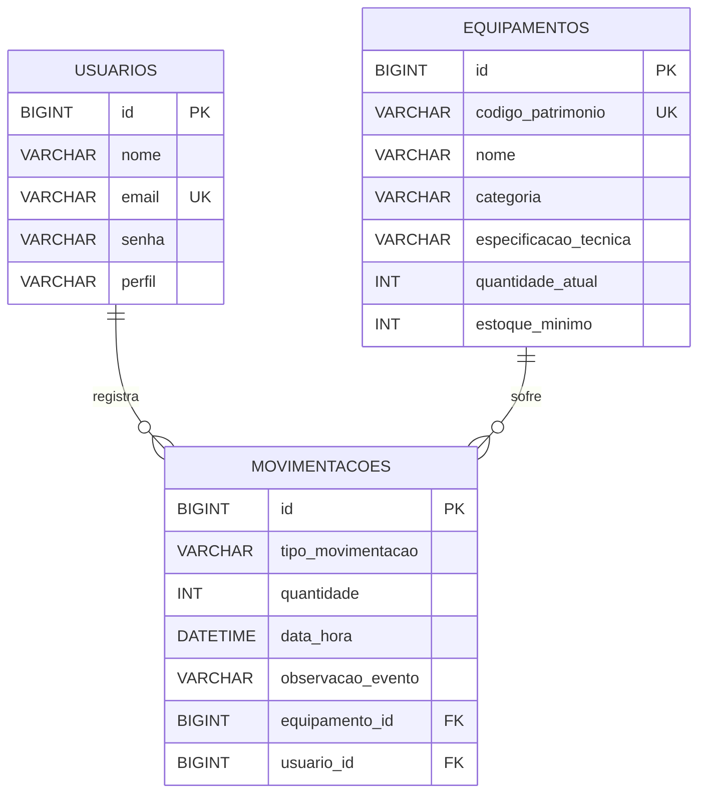

# ArenaXP - Gestão de Equipamentos E-Sports


Sistema web para controlar o estoque de equipamentos gamer (mouses, teclados, headsets, monitores e placas de captura) de uma rede de arenas e estúdios de e-sports. O sistema registra entradas e saídas, impede saídas maiores que o saldo, mostra um alerta destacado quando um item chega ao estoque mínimo e guarda o histórico de quem retirou cada equipamento.

> Projeto desenvolvido na Situação de Aprendizagem Prática do preparatório **SAEP 2026** (SENAI, Técnico em Desenvolvimento de Sistemas).

## O problema

Em uma final de campeonato, dois headsets queimaram ao mesmo tempo e a equipe técnica descobriu tarde demais que não havia reserva no almoxarifado. Ninguém sabia qual técnico tinha retirado os últimos equipamentos. O controle era feito em planilhas soltas e mensagens de WhatsApp.

O ArenaXP centraliza o cadastro, controla entradas e saídas com validação de saldo e avisa automaticamente quando um item atinge o nível mínimo de segurança.

## Funcionalidades

- **Login e logout** com e-mail e senha; o nome do técnico logado aparece no cabeçalho de todas as telas.
- **CRUD de equipamentos** com validação dos campos e mensagens de sucesso e erro.
- **Busca** por nome ou código de patrimônio (sem diferenciar maiúsculas e minúsculas) e **filtro por categoria**.
- **Gestão de estoque** em ordem alfabética (A-Z), com quantidade atual, estoque mínimo e status visual (verde = OK, vermelho = crítico).
- **Entradas e saídas** com data/hora e observação do evento ou torneio, vinculadas automaticamente ao usuário logado.
- **Alerta de estoque crítico** quando o saldo fica menor ou igual ao estoque mínimo.
- **Histórico de movimentações**, dos mais recentes para os mais antigos, com técnico responsável.
- **Painel inicial** com total de equipamentos, itens em alerta e movimentações registradas.

## Regras de negócio

| Regra | Comportamento |
|---|---|
| Saída maior que o saldo | Bloqueada, com mensagem de erro; o saldo não muda. |
| Saldo <= estoque mínimo após uma saída | Exibe o alerta "ESTOQUE CRÍTICO / ABAIXO DO MÍNIMO". |
| Código de patrimônio | Único; duplicado é rejeitado no formulário. |
| Quantidade atual e estoque mínimo | Não podem ser negativos. |
| Excluir equipamento com movimentações | Impedido com mensagem amigável, preservando o histórico. |
| Rotas internas | Exigem autenticação; quem não está logado vai para `/login`. |
| Saídas simultâneas | O saldo é atualizado com bloqueio pessimista, evitando saldo inconsistente. |

## Tecnologias

- **Java 17+** e **Spring Boot 3.5** (Web, Data JPA, Validation)
- **Spring Security** com senhas em hash **BCrypt**
- **Thymeleaf** para as páginas, com HTML5 e CSS próprios
- **MySQL 8+** (schema `arenaxp_db`)
- **Maven** para build
- **JUnit 5** e **Mockito** nos testes unitários da regra de saldo

## Modelo de dados

O banco `arenaxp_db` tem 3 tabelas. Cada movimentação pertence a um único equipamento e a um único usuário.



O script `02_Banco_de_Dados/arenaxp_db.sql` cria o banco, as tabelas com chaves e restrições (`UNIQUE`, `CHECK`, chaves estrangeiras) e uma carga inicial de 3 usuários, 5 equipamentos e 4 movimentações.

## Como executar

### Pré-requisitos

- JDK 17 ou superior
- Maven 3.8+
- MySQL 8+ em execução

### Passo a passo

1. **Clone o repositório**

   ```bash
   git clone <url-do-repositorio>
   cd <pasta-do-repositorio>
   ```

2. **Crie o banco e carregue os dados.** Atenção: o script apaga e recria as tabelas do `arenaxp_db`.

   ```bash
   mysql -u root -p < 02_Banco_de_Dados/arenaxp_db.sql
   ```

3. **Configure a conexão** em `03_Codigo_Fonte/arenaxp-app/src/main/resources/application.properties`, ajustando `spring.datasource.username` e `spring.datasource.password` para o seu MySQL.

4. **Inicie a aplicação**

   ```bash
   cd 03_Codigo_Fonte/arenaxp-app
   mvn spring-boot:run
   ```

5. **Acesse** `http://localhost:8081`. Se a porta estiver ocupada, altere `server.port` no `application.properties`.

### Usuários de teste

| E-mail | Senha | Perfil |
|---|---|---|
| `admin@arenaxp.com` | `admin123` | ADMIN |
| `carlos@arenaxp.com` | `tecnico123` | TECNICO |
| `marina@arenaxp.com` | `tecnico123` | COORDENADOR |

Essas credenciais existem apenas para demonstração.

## Telas e rotas

| Rota | Acesso | Descrição |
|---|---|---|
| `/login` | Público | Formulário de e-mail e senha, com erro para credenciais inválidas. |
| `/` | Autenticado | Painel com resumo e itens em alerta. |
| `/equipamentos` | Autenticado | Lista, busca, filtro por categoria, novo, editar e excluir. |
| `/estoque` | Autenticado | Lista A-Z, registro de entrada e saída e alerta de estoque mínimo. |
| `/movimentacoes` | Autenticado | Histórico cronológico de todas as movimentações. |

## Testes

Os testes unitários cobrem a regra de saldo (saída maior que o saldo, saída válida, entrada, saída que atinge o mínimo e quantidade inválida) e não precisam do MySQL:

```bash
cd 03_Codigo_Fonte/arenaxp-app
mvn test
```

O relatório com os 15 casos de teste e as evidências em tela está em [`04_Testes/Relatorio_Testes_Evidencias.pdf`](SAEP_2026_Projeto01_ArenaXP_ArthurMartins/04_Testes).

## Estrutura do repositório

```text
.
├── 01_Documentacao/        DER conceitual, MER lógico e README de execução
├── 02_Banco_de_Dados/      arenaxp_db.sql (DDL + carga inicial)
├── 03_Codigo_Fonte/
│   └── arenaxp-app/        projeto Maven Spring Boot
│       └── src/main/java/br/senai/arenaxp/
│           ├── model/        entidades JPA
│           ├── repository/   Spring Data JPA
│           ├── service/      regra de saldo e estoque
│           ├── controller/   rotas e telas
│           └── security/     Spring Security e BCrypt
└── 04_Testes/              relatório de testes e evidências
```

## Autor

**Arthur Martins Teixeira Coragem**
Técnico em Desenvolvimento de Sistemas, SENAI.
